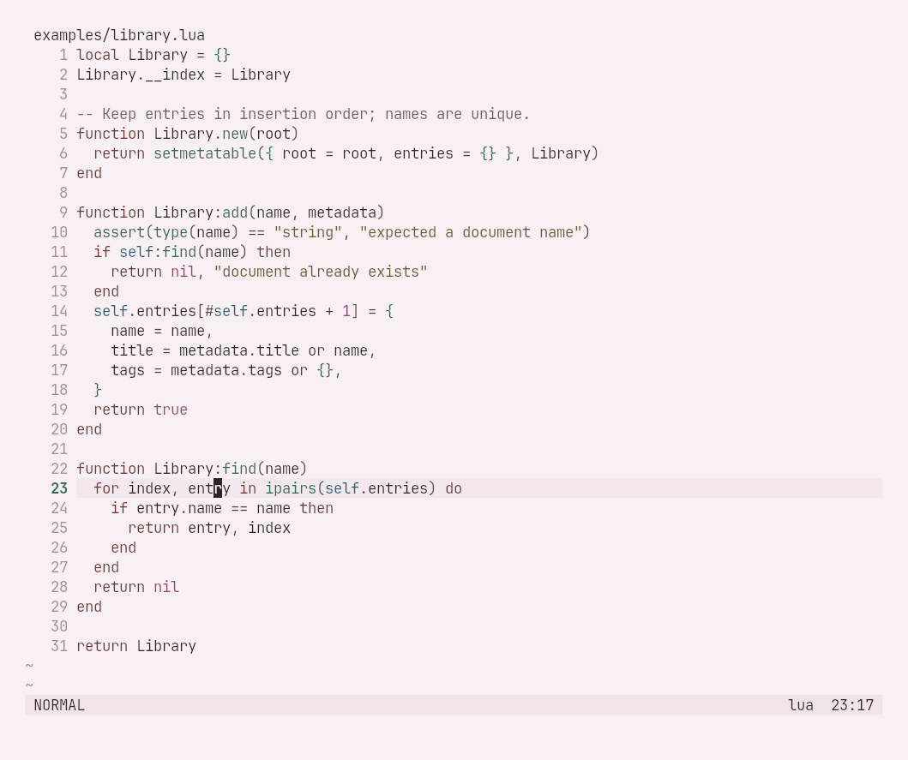
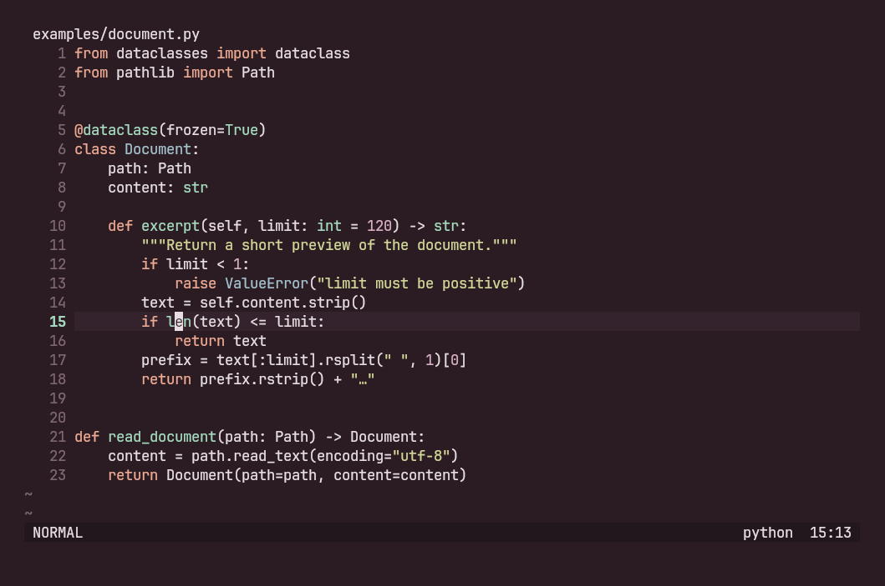
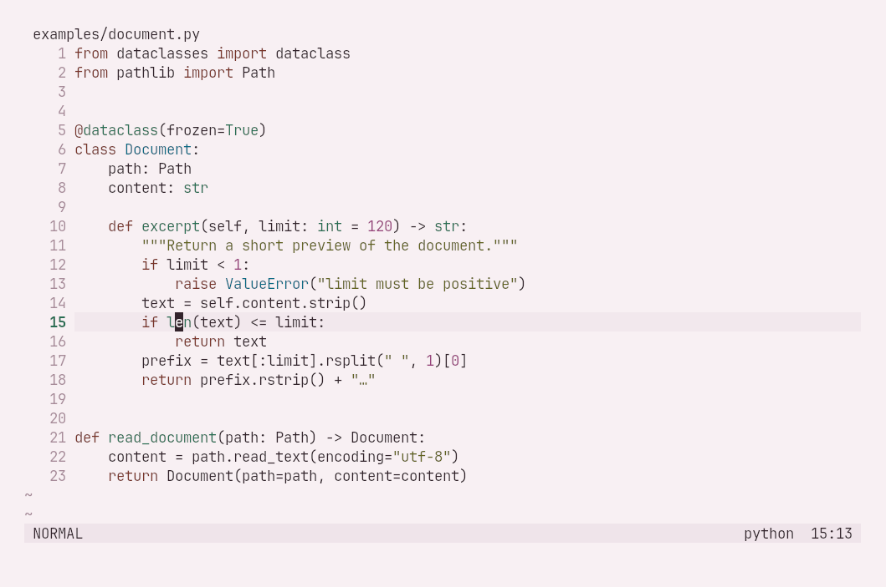
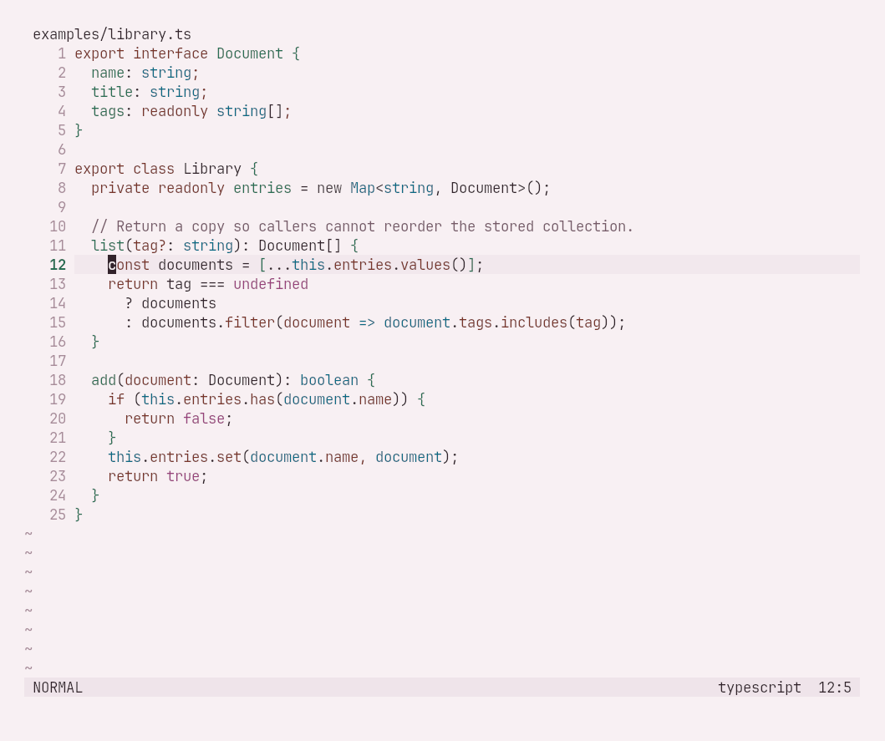
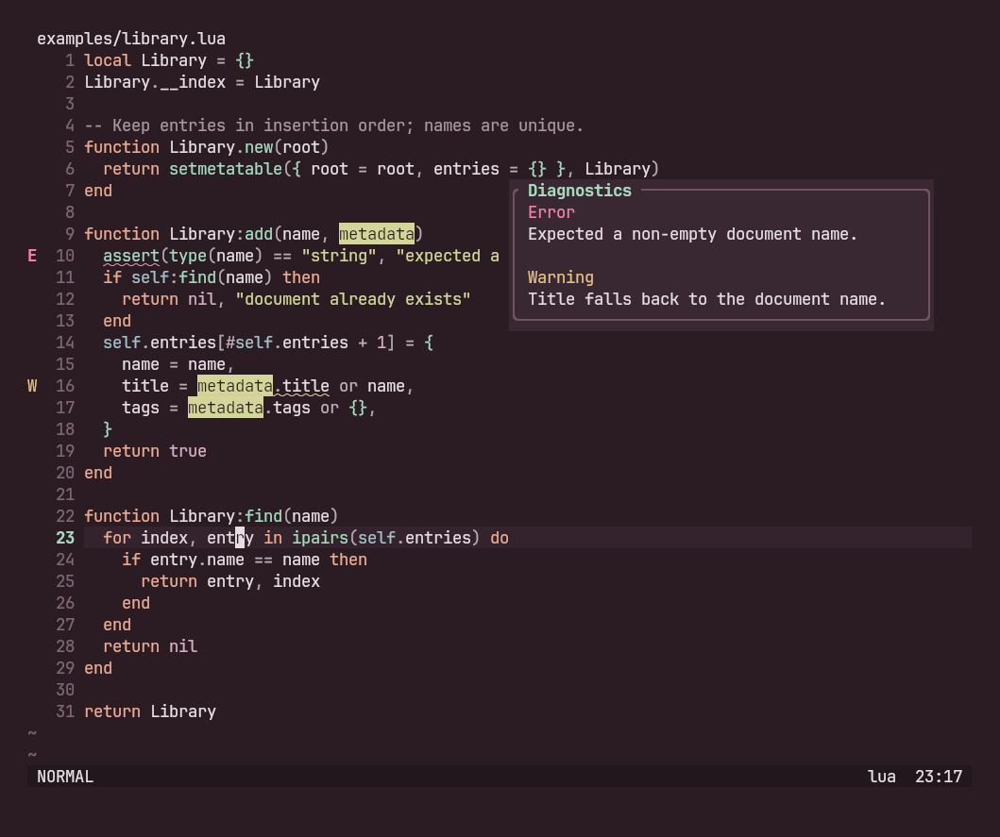
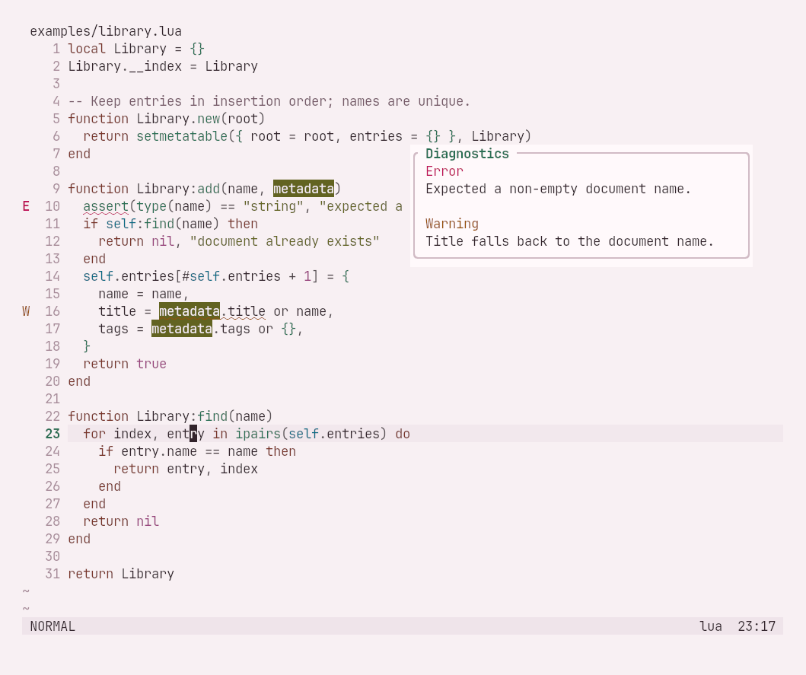
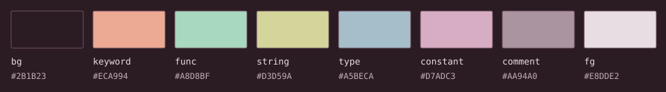
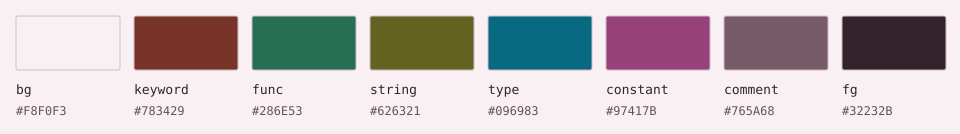

<h1>
  <picture>
    <source media="(prefers-color-scheme: dark)" srcset="assets/wordmark-dark.png">
    <source media="(prefers-color-scheme: light)" srcset="assets/wordmark-light.png">
    
  </picture>
</h1>

Cherry ink at night, blush paper by day. A dark and light colorscheme for editors and terminals.

**Dark** · celadon functions, apricot keywords, and pale citrine strings.


**Light** · jade functions, terracotta keywords, and olive citrine strings.



## Install

### Neovim

Neovim 0.10+ and a truecolor terminal. With lazy.nvim:

```lua
{
  "librerob/morello",
  lazy = false,
  priority = 1000,
  config = function()
    vim.o.background = "dark" -- "light" for blush paper
    vim.cmd.colorscheme("morello")
  end,
}
```

For a manual install, copy `colors/morello.lua` and `lua/` into the corresponding directories in `vim.fn.stdpath("config")`.

Morello follows Neovim's `background` setting. Change it with `:set background=light` or `:set background=dark`; the colorscheme reloads automatically.

Comment italics are optional, set before loading:

```lua
require("morello").setup({ italic_comments = true })
```

Includes standard syntax, Treesitter, LSP semantic tokens, diagnostics, diffs, and terminal colors. There are highlight mappings for Telescope, Neo-tree, Oil, Gitsigns, Which-key, blink.cmp, nvim-cmp, and Snacks. Their plugins and language parsers are installed separately. For lualine, set `options.theme = "morello"` in your lualine setup.

### Vim

Vim 8.2+ with truecolor support, or gVim. Copy [colors/morello.vim](colors/morello.vim) to `~/.vim/colors/morello.vim`, or install this repository through your Vim plugin manager. In your vimrc:

```vim
syntax enable
set termguicolors
set background=dark
colorscheme morello
```

Use `set background=light` for the light variant. For italic comments, add `let g:morello_italic_comments = 1` before `colorscheme morello`.

The Vim port uses the same palettes and core UI and syntax definitions as Neovim. Token coloring can differ because Vim's syntax files and Neovim's Treesitter or LSP highlighting classify code differently. Neovim plugin integrations belong to the Neovim port. Truecolor is required for the documented HEX colors; there is no separate 256-color approximation.

### Terminals

| App | Dark | Light | Setup |
| --- | --- | --- | --- |
| Alacritty | [alacritty.toml](ports/alacritty/alacritty.toml) | [alacritty-light.toml](ports/alacritty/alacritty-light.toml) | Import your chosen file through the existing `[general]` import array. |
| Kitty | [kitty.conf](ports/kitty/kitty.conf) | [kitty-light.conf](ports/kitty/kitty-light.conf) | Include your chosen file after other color settings. |
| Ghostty | [Morello](ports/ghostty/Morello) | [Morello Light](ports/ghostty/Morello%20Light) | Copy to `~/.config/ghostty/themes/`, then set `theme = Morello` or `theme = Morello Light`. |
| Windows Terminal | [Morello.json](ports/windows-terminal/Morello.json) | [Morello Light.json](ports/windows-terminal/Morello%20Light.json) | Add either object to `schemes`, then choose it in your profile's Appearance settings. |
| Xfce Terminal | [Morello.theme](ports/xfce-terminal/Morello.theme) | [Morello Light.theme](ports/xfce-terminal/Morello%20Light.theme) | Copy to `~/.config/xfce4/terminal/colorschemes/`, reopen Preferences → Colors, then choose the preset. |
| foot | [morello.ini](ports/foot/morello.ini) | Both variants in the same file | See the include example below. |
| Konsole | [Morello.colorscheme](ports/konsole/Morello.colorscheme) | [Morello Light.colorscheme](ports/konsole/Morello%20Light.colorscheme) | Copy to `~/.local/share/konsole/`, then select it under Edit Current Profile → Appearance. |

These files set colors only. Editor syntax highlighting needs its editor theme too.

For current foot, copy `ports/foot/morello.ini` to `~/.config/foot/morello.ini`. Add the following in the main section of `foot.ini`, before other section headers:

```ini
include=~/.config/foot/morello.ini
initial-color-theme=dark
```

Set `initial-color-theme=light` for blush paper. The file uses the current [`colors-dark` and `colors-light` sections](https://man.archlinux.org/man/foot.ini.5.en). For foot before 1.26, include [morello-legacy.ini](ports/foot/morello-legacy.ini) or [morello-light-legacy.ini](ports/foot/morello-light-legacy.ini) instead, and omit `initial-color-theme`.

Konsole controls cursor and selection behavior through profile settings. Its port specifies the shared foreground, background, normal/bright ANSI colors, and faint entries; it does not force selection colors through unsupported scheme keys.

### VS Code

The [VS Code port](ports/vscode) includes both variants, workbench colors, TextMate scopes, semantic tokens, and matching terminal palettes. It is not published on the Marketplace. To try it locally, copy that directory into `~/.vscode/extensions/librerob.morello-theme-0.2.0`, reload VS Code, then choose **Morello** or **Morello Light** from **Preferences: Color Theme**.

## Previews

### Python





### TypeScript



### Search, diagnostics, and a floating panel





These are captures of Neovim running in Kitty with JetBrains Mono, the matching Kitty port, and a minimal built-in winbar and statusline. The UI views use illustrative Error and Warning diagnostics with text labels. Lua uses the bundled Treesitter parser; Python and TypeScript use the built-in syntax definitions. The examples and capture script are included. Captures are checked for a rendered theme background, text, and syntax colors before replacing the published previews. No image filters or transparency are used.

## Colors





The base is a dark red-violet, with a darker matching panel color. Apricot marks control flow, celadon marks functions, and citrine marks strings. Types use a quieter blue-grey; ordinary variables remain off-white. Neutral punctuation sits above the mauve comments. Raspberry errors are distinct from the apricot keywords; error signs and error messages also use bold text.

The light variant uses a quiet blush ground with deep cherry text. Terracotta, jade, and olive citrine preserve the warm keywords, cool functions, and yellow-green strings of the dark variant at readable light-theme values.

Body text contrast is **12.36:1** in dark and **13.29:1** in light. Core syntax, punctuation, and comments pass **4.5:1** on the background, panel, cursor line, and floating surface in both variants. The light variant also tests every core text color on selection and diff backgrounds. The reports cover **348 pairs** in total, including search and UI states. Inactive line numbers, passive borders, and utility ANSI slots are deliberate exceptions: dark uses ANSI 0 as a dark surface; light keeps ANSI 7 and 15 as pale backgrounds. Transparency, dim attributes, and other plugins may change contrast.

[Dark palette](docs/PALETTE.md) · [Light palette](docs/PALETTE-LIGHT.md) · [Dark contrast](docs/contrast-report.json) · [Light contrast](docs/contrast-report-light.json) · [Design notes](docs/DESIGN.md)

## Development

`palette.json` and `palette-light.json` are the sources for every port. With Python 3.11+:

```sh
python scripts/sync_ports.py
python scripts/sync_extras.py
python scripts/sync_vim.py
python scripts/verify.py
python scripts/verify_extras.py
nvim --headless -u NONE -l tests/headless.lua
vim -Nu NONE -n -es -S tests/vim.vim
```

To refresh both sets of screenshots on Linux, install Kitty, Xvfb, xdotool, ImageMagick, JetBrains Mono, Python 3 with Pillow, and Neovim, then run:

```sh
xvfb-run -a bash scripts/capture.sh
```

`NVIM_BIN` can override Neovim on `PATH`. On a headless machine without a GPU, add `LIBGL_ALWAYS_SOFTWARE=1` before `xvfb-run`. `require("morello").get_palette()` returns the active palette. For a fixed variant without changing editor settings, use `require("morello.palette")` or `require("morello.palette-light")`. ANSI entries use indices 0–15.

## License

[MIT](LICENSE).
